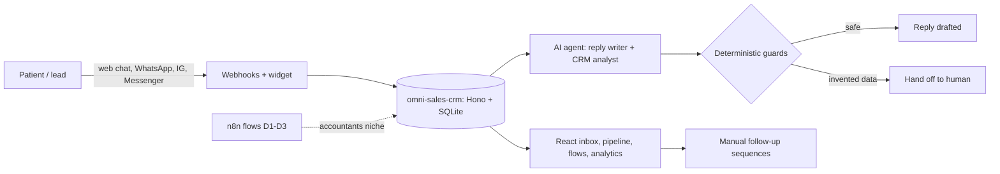

# Loovo

*Automatizacion de ventas con IA para clinicas esteticas y odontologicas. Construido en publico por un solo fundador y un equipo de agentes.*

Loovo sells AI sales automation to aesthetic and dental clinics in Colombia (Bucaramanga, Medellin), plus new niches such as accountants. This repo is the working tree of the company, with all client and lead data removed: the product code, the n8n flows, the content pipeline, and the way I orchestrate AI agents to run all of it as a one-person operation.

## The problem

A clinic loses most of its leads in the first hours: a patient writes on Instagram or WhatsApp at 9 pm, nobody answers until tomorrow, and the patient books somewhere else. Generic chatbots make it worse by inventing prices and promises.

## What is in here

- **`servicios/omni-sales-crm/`** - an omnichannel inbox with an AI sales agent, Kanban pipeline, automation flow builder, manual follow-up sequences ("Today" view) and live analytics. Single tenant: one instance per client.
  - The agent answers prices and conditions only from a knowledge base, and deterministic guards rewrite or hand off to a human if a draft invents amounts, schedules, payment links or guarantees.
  - Channels: web chat widget (tested end to end); WhatsApp/Messenger/Instagram via Meta webhooks and an Evolution webhook (covered by tests with simulated APIs, **not yet validated with live credentials**).
- **`servicios/Agentes de IA/contadores-d1-d2-d3/`** - three n8n workflows for Colombian accountants: a tax-code chat agent (D1), an invoice extractor with NIT/CUFE/total validation (D2), and a deterministic bank reconciler with an AI summary (D3). Node-side logic is tested against fictional data; **the JSON files have not been imported or run in n8n yet (in progress).**
- **`Maquina de redes/`** - the content machine: a "Day N of 42" video series, scripts and plans, editing/render scripts in Python, and Instagram tooling. Raw footage, renders and images are not included.
- **`odd/`, `AGENTS.md`, `MEMORY.md`** - the agent orchestration layer: single source of truth for agent rules, delegation policy, task logs and persistent memory conventions (Organic Driven Development).
- **`landings/`** - only the module rules; the sites themselves are not in this repo.

## Architecture



Sending is manual by design: the AI drafts, a human sends (one narrow exception for inbound replies is documented in `AGENTS.md`).

## Tech stack

TypeScript, Hono (Node), `node:sqlite`, React 19, Vite, Tailwind 4, React Flow, dnd-kit, Vitest. LLM providers behind a fallback chain (OpenAI, NVIDIA NIM, Anthropic). n8n, Qdrant for retrieval. Python and JavaScript for media tooling. Claude Code and Pi as agent harnesses.

## Project structure

```
servicios/
  omni-sales-crm/        server/ (Hono API, agent, guards), web/ (React), tests/, odd/ (specs + evidence)
  Agentes de IA/         n8n flows + test scripts + fictional test data
Maquina de redes/        series scripts, plans, edit/render scripts, Instagram tooling
odd/                     reports and task logs
AGENTS.md  MEMORY.md     agent rules and living memory
```

## How to run the CRM

```bash
cd servicios/omni-sales-crm
npm install
npm run build
ADMIN_PASSWORD=change-me npm start      # http://localhost:3000
npm test                                 # vitest
```

Without an AI key it falls back to a rule engine (demo only). See `servicios/omni-sales-crm/README.md` and `.env.example` for channels and keys. The n8n flows: import the JSON files, replace the `REEMPLAZAR` credentials, and read the README next to them.

## What I learned

- Guardrails beat prompts: checking drafts for invented numbers in code is more reliable than asking the model nicely.
- Mark honestly what is tested. "Implemented with a simulated API" and "works with the real channel" are different states, and the repo says which is which.
- Splitting work into small specs with a task log lets agents resume without me re-explaining.
- Selling to clinics is mostly operations: timing, tone and handoff rules matter more than model choice.

## Status

Active, solo-founder project. Items marked above as in progress are not production-validated. Client data, lead lists and the sales pipeline are intentionally excluded.

