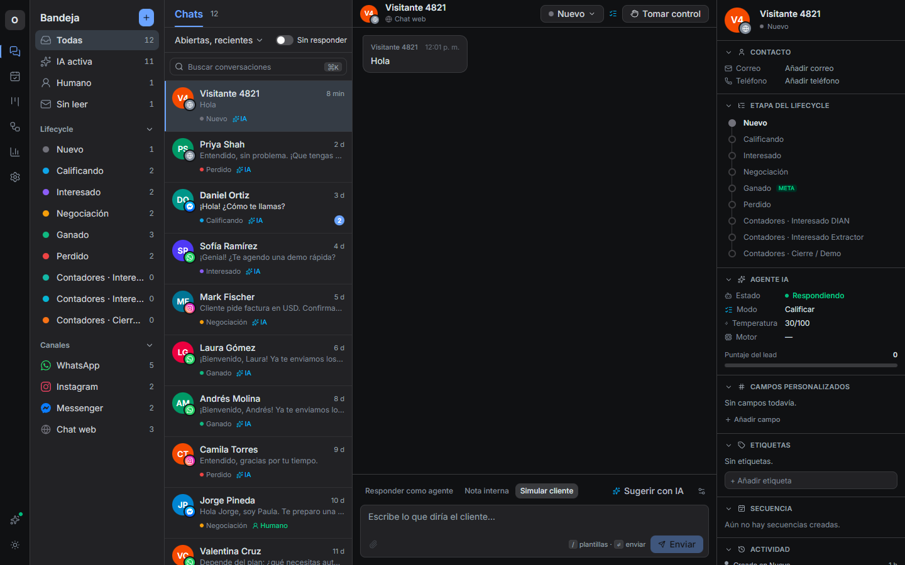
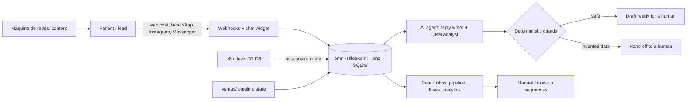

# Loovo

*AI sales automation for aesthetic and dental clinics. Built in public by one founder and a team of AI agents.*

Loovo sells AI sales automation to aesthetic and dental clinics in Colombia (Bucaramanga and Medellin), plus new niches such as accountants. This repository is the whole working tree of the company: the CRM, the n8n flows, the sales pipeline, the content machine, and the agent rules used to run it as a one-person operation. Client and lead data is replaced with fictional placeholders; raw footage, audio, databases and secrets are not included.

## Screenshots



*Omni Sales CRM: unified inbox across WhatsApp, Instagram, Messenger and web chat, with lifecycle stages and AI-assisted replies. Demo data is fictional.*

## The problem

A clinic loses most of its leads in the first hours. A patient writes on Instagram or WhatsApp at 9 pm, nobody answers until the next morning, and the patient books somewhere else. Generic chatbots make it worse because they invent prices and promises.

## The solution

- **An omnichannel inbox with an AI sales agent** ([omni-sales-crm](https://github.com/Monoga2025/omni-sales-crm)). The agent answers prices and conditions only from the clinic's knowledge base. Deterministic guards rewrite a draft or hand it to a human when it invents amounts, schedules, payment links or guarantees.
- **Manual-send by design.** The AI drafts; a person sends. Follow-up sequences show up in a "Today" view and nothing leaves the system on its own.
- **Accountant niche flows** (`servicios/Agentes de IA/`): three n8n workflows for Colombian tax questions, invoice extraction and bank reconciliation.
- **A content machine** (`Maquina de redes/`) that turns daily recordings into short videos, covers and captions.
- **A sales operating system** (`ventas/`, `clientes-activos/`, `tablero/`): pipeline state, outreach scripts, delivery templates and a shared board.

## Architecture



## Modules

| Folder | What it is | README |
|---|---|---|
| `servicios/` | Product code: the CRM and the n8n flows | [servicios/README.md](servicios/README.md) |
| [`omni-sales-crm`](https://github.com/Monoga2025/omni-sales-crm) | Omnichannel CRM with an AI agent, pipeline and sequences | [README](https://github.com/Monoga2025/omni-sales-crm) |
| `servicios/Agentes de IA/` | n8n workflows for the accountant niche | [README](servicios/Agentes%20de%20IA/README.md) |
| `ventas/` | Sales operation: pipeline state, scripts, offers | [README](ventas/README.md) |
| `ventas/agentes/` | Prompt files for the sales agents | [README](ventas/agentes/README.md) |
| `ventas/evolution-railway/` | Ops script to purge non-clinic contacts from the hosted CRM | [README](ventas/evolution-railway/README.md) |
| `ventas/prospectos/` | Prospect lists (sanitized) | [README](ventas/prospectos/README.md) |
| `ventas/whatsapp-mcp/` | Vendored copy of an open-source WhatsApp MCP bridge; see its own README and LICENSE | [README](ventas/whatsapp-mcp/README.md) |
| `clientes-activos/` | One folder per paying client, plus delivery template | [README](clientes-activos/README.md) |
| `landings/` | Lead landing pages (rules only in this repo) | [README](landings/README.md) |
| `Maquina de redes/` | Content pipeline: the "Day X of 42" series, channel cuts, Instagram tooling | [README](Maquina%20de%20redes/README.md) |
| `tablero/` | Shared board: open items per area | [README](tablero/README.md) |
| `odd/` | Feature specs and reports for the agent workflow | [README](odd/README.md) |

Module rules for the agents live in `AGENTS.md` (single source) and in each module's own `AGENTS.md`. Shared memory lives in `MEMORY.md`.

## Stack

TypeScript, Hono on Node, `node:sqlite`, React 19, Vite, Tailwind 4, React Flow, dnd-kit, Vitest. LLM providers behind a fallback chain (OpenAI, NVIDIA NIM, Anthropic). n8n and Qdrant for the accountant flows. Python and JavaScript for media tooling. Claude Code and Pi as agent harnesses.

## Status

Honest status, module by module:

- 🟡 **CRM ([omni-sales-crm](https://github.com/Monoga2025/omni-sales-crm))**: the web chat widget and the inbox are covered by the test suite. WhatsApp, Messenger and Instagram paths are covered by tests with simulated APIs and are **not yet validated with live credentials**.
- 🟡 **Accountant flows (`servicios/Agentes de IA`)**: the Node code of the flow nodes is tested with fictional data. The three JSON workflows **have not been imported or run in n8n yet**.
- 🟡 **Content machine**: day-by-day render and edit tooling exists; publishing is manual and no end-to-end automated release is in place.
- 🟡 **Sales operation**: outreach is manual; the pipeline is a working document, not a measured conversion funnel.

## How to run the CRM

```bash
git clone https://github.com/Monoga2025/omni-sales-crm
cd omni-sales-crm
npm install
npm run build
ADMIN_PASSWORD=change-me npm start      # http://localhost:3000
npm test                                 # vitest
```

Without any AI key the agent falls back to a rule engine, which is for demos only. Channel keys go in a local `.env` (copy `.env.example`; never commit it). The n8n flows: import the JSON, replace the `REEMPLAZAR` credentials, and read the README next to them.

## What I learned

- Guardrails beat prompts: checking a draft for invented numbers in code is more reliable than asking the model nicely.
- Mark honestly what is tested. "Works with a simulated API" and "works with the real channel" are different states, and the repo says which is which.
- Small specs with a task log let agents resume work without re-explaining it.
- Selling to clinics is mostly operations: timing, tone and handoff rules matter more than the model choice.

## Sales playbooks and prospecting

Consolidated sales material lives under `ventas/`: a unified 6-stage funnel, an objection matrix and generic agent rules in `ventas/playbooks/`, a runnable prospect-store sub-project (synthetic data, with tests) in `ventas/prospecting/`, and agency ideas in `docs/agency-notes.md`.

## Repository hygiene

Excluded on purpose: `.env` files (except `.env.example`), keys and certificates, databases and session stores, agent runtime folders, `node_modules`/build output, raw video and audio, and files over 20 MB. Client and lead names, doctors, phone numbers, e-mail addresses, the hosting project host name and local user paths were replaced with placeholders. The founder name appears as the brand name.
